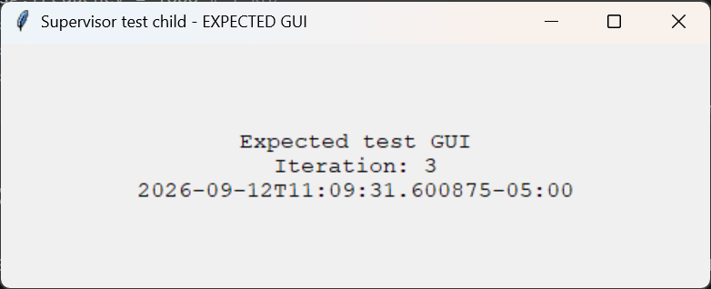

# `supervisor` in Linux

This repo contains a `uv` project and templates to run [`supervisor`](https://pypi.org/project/supervisor/) on Linux.


## Table of Contents

1. [How to use `supervisor`](#how-to-use-supervisor)
2. [Adding an app to `supervisor`](#adding-an-app-to-supervisor)
3. [Quick installation with `uv`](#quick-installation-with-uv)
4. [One-shot setup script](#one-shot-setup-script)
5. [Manual `systemd` setup](#manual-systemd-setup)
6. [Testing with the included child app](#testing-with-the-included-child-app)
7. [Uninstalling `supervisor`](#uninstalling-supervisor)
8. [Remove an old package-manager install](#remove-an-old-package-manager-install)
9. [Developer's note](#developers-note)

## How to use `supervisor`

### Startup `supervisor`

The `supervisor` user service in `systemd` should run automatically after starting up the computer and logging into the Linux account.

To start the `supervisor` service manually, run the command below in a Bash terminal to start `supervisord` installed as a service in `systemd`:

   ```bash
   systemctl --user start supervisor
   ```

### Monitoring & Managing processes

There are Web UI and CLI to monitor and manage the processes registered in `supervisor`.
The Web UI requires logging in; use the `username` and `password` set in the `[inet_http_server]` section in the `supervisord.conf` file.
The CLI connects through a user-only Unix socket and does not require those credentials.

#### Web UI

Open `http://localhost:9001` in a browser to use the Supervisor web UI, and it will show the statuses of the registered processes and let you control them.

[`multivisor`](https://github.com/SinclairQuantumLab/multivisor-web.git) provides a nice centralized monitoring and control Web dashboard if the `supervisor` is set up for it (see the relevant step in the [Quick installation with uv](#quick-installation-with-uv) section) and registered with a `multivisor` server.

#### CLI

In a Bash terminal, run from the repository folder so `supervisorctl` finds its `supervisord.conf`:

```bash
cd "$HOME/Projects/supervisor"
supervisorctl
```

One can either establish a supervisor control session with a `supervisor>` prompt or directly call the `supervisorctl` commands below without entering the `supervisor` session, as in the example below:

```bash
supervisorctl status
```

##### `supervisorctl` commands

Check the statuses of registered processes:

```bash
supervisor> status
```

Start, stop, or restart one app:

```bash
supervisor> start myapp
supervisor> stop myapp
supervisor> restart myapp
```

### Shutdown `supervisor`

   ```bash
   systemctl --user stop supervisor
   ```

## Adding an app to `supervisor`

1. Copy the app config template in `$HOME/Projects/supervisor/conf.d/` folder:

   ```bash
   cd "$HOME/Projects/supervisor"
   cp './conf.d/[APPNAME].conf.template' './conf.d/<APPNAME>.conf'
   ```

   Replace: `<APPNAME>` with the name of the app in `supervisor`.

2. Edit the `.conf` above.

   Replace:

   - `<APPNAME>` with the Supervisor app name
   - `command=` with the real app startup command

      For a Python app,

      1. Copy `python/Startup.sh` into the app project folder and configure it; especially, update the location of the Python script to run in the `py_path` variable.
      2. In the `.conf` file, set the following:

         ```ini
         command=/usr/bin/env bash "%(ENV_HOME)s/Projects/%(program_name)s/Startup.sh"
         ```

      In `supervisor`, `%(ENV_HOME)s` and `%(program_name)s` refer to `$HOME` and the app's name set in the `.conf` file.

      In an included app config, `%(here)s` refers to that config file's own directory. The template therefore writes app logs under `$HOME/Projects/supervisor/conf.d/logs/`.

   Add further configuration items found in https://supervisord.org/configuration.html#program-x-section-settings or https://supervisord.org/configuration.html#group-x-section-settings as needed.

3. Connect through the [CLI](#cli), then run `update` to apply the new `.conf` file. The example below uses `myapp` as the app name:

   ```text
   supervisor> update
   myapp: added process group
   ```

   If the config has `autostart=false`, run `start` to launch the app:

   ```text
   supervisor> start myapp
   myapp: started
   ```

   Check if the new app appears in the `supervisor` interface; see [Monitoring & Managing processes](#monitoring--managing-processes).

To remove an app from Supervisor, delete its `.conf` from `conf.d` and run `update` again. This stops the app and removes its registration.

## Quick installation with `uv`

If this computer already has an old `supervisor` installed through a Linux package manager, remove it first. See the [Remove an old package-manager install](#remove-an-old-package-manager-install) section.

1. If `uv` has not been installed, install it by following [the official installation guide](https://docs.astral.sh/uv/getting-started/installation/).
   **Close and reopen Bash after installing `uv`**.

2. Open Bash and clone this repo in the `$HOME/Projects/` folder:

   ```bash
   mkdir -p "$HOME/Projects"
   cd "$HOME/Projects"
   git clone https://github.com/SinclairQuantumLab/supervisor-linux.git supervisor
   ```

3. Go to the created folder and run `uv sync`:

   ```bash
   cd supervisor
   SUPERVISOR_DIR="$PWD"
   uv sync
   ```

   The current location is stored in `$SUPERVISOR_DIR` variable as the path to `supervisor` repo.

4. Make `supervisorctl` available from Bash.

   ```bash
   mkdir -p "$HOME/.local/bin"
   ln -sf "$SUPERVISOR_DIR/.venv/bin/supervisorctl" "$HOME/.local/bin/supervisorctl"
   ```
   
   `supervisorctl` can be tested running:

   ```bash
   ./.venv/bin/supervisorctl
   # OR
   uv run supervisorctl
   ```

   The `supervisor>` prompt should appear. A connection error is expected before the service is started.

   Entering `exit` to the prompt will let you go back to bash prompt.


5. Create the `supervisord` config file from the template:

   ```bash
   cp ./supervisord.conf.template ./supervisord.conf
   ```

   Open the `supervisord.conf` file and replace the `<PASSWORD>` placeholder with our usual password, manually or by running the commandline below after replacing `<PASSWORD_INPUT>` with the password to use.

   ```bash
   sed -i 's/<PASSWORD>/<PASSWORD_INPUT>/g' ./supervisord.conf
   ```

   Make sure to replace `<PASSWORD_INPUT>` INCLUDING the angled parantheses "<>"

   If the password contains `'`, `/`, `&`, or `\`, edit the file directly.

6. Create the `systemd` service config file from the template:

   ```bash
   cp ./supervisor.service.template ./supervisor.service
   ```

   Open the `supervisor.service` file and replace the `<SUPERVISOR_DIR>` placeholder with the path to the `supervisor` repo , manually or by running the commandline below:

   ```bash
   sed -i "s|<SUPERVISOR_DIR>|$SUPERVISOR_DIR|g" ./supervisor.service
   ```

   Then, create the symlink for the file to the location for local `systemd` service files:

   ```bash
   mkdir -p "$HOME/.config/systemd/user/"
   ln -sf "$SUPERVISOR_DIR/supervisor.service" "$HOME/.config/systemd/user/supervisor.service"
   ```

7. Create a local `systemd` service named `supervisor.service` (or `supervisor` in short form) that runs `supervisord`.

   ```bash
   systemctl --user daemon-reload
   ```

   Check if the service is registered.
   
   ```bash
   systemctl --user status supervisor --no-pager
   ```

   The output should look like:

   ```bash
   * supervisor.service - Supervisor process control system for UNIX
         Loaded: loaded (/home/imaq/.config/systemd/user/supervisor.service; linked; preset: enabled)
         Active: inactive (dead)
            Docs: https://supervisord.org/
   ```

   Enable it to make it autostart after boot & user login and check the status again:

   ```bash
   systemctl --user enable supervisor
   systemctl --user status supervisor --no-pager
   ```

   The output should replace "linked" with "enabled".

8. Start the `systemd` service and check the status:

   ```bash
   systemctl --user start supervisor
   systemctl --user status supervisor --no-pager
   ```

   The output should look like:

   ```bash
   * supervisor.service - Supervisor process control system for UNIX
         Loaded: loaded (/home/imaq/.config/systemd/user/supervisor.service; enabled; preset: enabled)
         Active: active (running) since Wed 2026-08-05 13:25:01 CDT; 1min 3s ago
      Invocation: b7226360987d4d529f9aeeaf3212414f
            Docs: https://supervisord.org/
         Main PID: 438267 (supervisord)
            Tasks: 1 (limit: 4805)
            CPU: 144ms
         CGroup: /user.slice/user-1000.slice/user@1000.service/app.slice/supervisor.service
                  `-438267 /home/imaq/Projects/supervisor/.venv/bin/python /home/imaq/Projects/supervisor/.venv/bin/supervisord -n -c /home/imaq/Projects/supervisor/supervisord.conf
   ```

9. Test if `supervisor` runs successfully.

   - Web UI: go to `http://localhost:9001` in a web browser and `supervisor` is running if it shows the control UI. Use the `username` and `password` in the `supervisord.conf` file to log in.

   - Terminal CLI: 

      ```bash
      cd "$HOME/Projects/supervisor"
      supervisorctl
      ```

      The `supervisor>` prompt should now appear without the connection error from step 4.


      The following commands are useful for checking the service and troubleshooting startup:

      ```bash
      systemctl --user status supervisor # showing status in a `less` session
      systemctl --user status supervisor --no-pager # printing the status to terminal output (`stdout`) and return to prompt promptly
      journalctl --user -u supervisor.service -n 50 # showing recent logs
      journalctl --user -u supervisor.service -f # showing logs in real time
      systemctl --user cat supervisor # showing the `supervisor.service` file's contents
      ```

10. (Optional) register the installed `supervisor` with `multivisor`.

      Test if `multivisor[rpc]` has been installed and can be properly called.

      ```bash
      uv run python -c "from multivisor.rpc import make_rpc_interface; print('RPC import OK')"
      ```

      The output should show `RPC import OK` with no error.

      Then uncomment the below lines in `$HOME/Projects/supervisor/supervisord.conf` to connect the supervisor to multivisor:

      ```ini
      [rpcinterface:multivisor]
      supervisor.rpcinterface_factory = multivisor.rpc:make_rpc_interface
      bind=<TRUSTED_INTERFACE_IP>:9002
      ```

      Replace `<TRUSTED_INTERFACE_IP>` with `127.0.0.1` for a Multivisor server on this computer, or a private IP reachable only from the trusted Multivisor server. This RPC endpoint has no authentication; do not expose it to an untrusted network.

      Restart `supervisor` daemon to load the new configuration.

      ```bash
      systemctl --user restart supervisor
      ```

That's it. `supervisord` should now start automatically when this Linux computer boots and you log in.

## One-shot setup script

Copy and paste the script below into a Bash terminal opened as the deployment user.

```bash
(
set -euo pipefail

install_dir="$HOME/Projects/supervisor"
if [[ -e "$install_dir" ]]; then
    printf 'Refusing to overwrite existing path: %s\n' "$install_dir" >&2
    exit 1
fi

# install supervisor-linux in ~/Projects/supervisor
mkdir -p "$HOME/Projects"
cd "$HOME/Projects"
git clone https://github.com/SinclairQuantumLab/supervisor-linux.git supervisor
cd supervisor
uv sync
# create symbolic link for supervisorctl in user `bin` folder
mkdir -p "$HOME/.local/bin"
ln -sf "$(pwd -P)/.venv/bin/supervisorctl" "$HOME/.local/bin/supervisorctl"
# create `supervisord.conf` file from the template
cp ./supervisord.conf.template ./supervisord.conf
chmod 600 ./supervisord.conf
)
```

**Make sure to replace the `<PASSWORD>` placeholder with our usual password in `$HOME/Projects/supervisor/supervisord.conf`.**

Then register and start the service:

```bash
(
set -euo pipefail
cd "$HOME/Projects/supervisor"
SUPERVISOR_DIR="$PWD"
# create `supervisor.service` file from the template
cp ./supervisor.service.template ./supervisor.service
sed -i "s|<SUPERVISOR_DIR>|$SUPERVISOR_DIR|g" ./supervisor.service
# register and enable the user service
mkdir -p "$HOME/.config/systemd/user/"
ln -sf "$SUPERVISOR_DIR/supervisor.service" "$HOME/.config/systemd/user/supervisor.service"
systemctl --user daemon-reload
systemctl --user enable supervisor
# start `supervisor` service
systemctl --user start supervisor
)
```

See steps 9–10 of [Quick installation with `uv`](#quick-installation-with-uv) for the Web UI/CLI checks and optional Multivisor setup.

## Manual `systemd` setup

While the Bash script in [One-shot setup script](#one-shot-setup-script) provides a quick way to set up the `supervisor` service, manual `systemd` setup is also useful because it shows the Linux settings directly. Complete steps 1–5 of [Quick installation with `uv`](#quick-installation-with-uv) first, then use the steps below in place of steps 6–8.

1. Copy the `supervisor.service.template` file in this repo in the same top folder without `.template` extension, manually or by running the below commandline in terminal:

   ```bash
   cd "$HOME/Projects/supervisor"
   cp ./supervisor.service.template ./supervisor.service
   ```

   ```ini
   [Unit]
   Description=Supervisor process control system for UNIX
   Documentation=https://supervisord.org/
   After=network.target

   [Service]
   Type=simple
   ExecStart=<SUPERVISOR_DIR>/.venv/bin/supervisord -n -c <SUPERVISOR_DIR>/supervisord.conf
   ExecStop=<SUPERVISOR_DIR>/.venv/bin/supervisorctl -c <SUPERVISOR_DIR>/supervisord.conf $OPTIONS shutdown
   ExecReload=<SUPERVISOR_DIR>/.venv/bin/supervisorctl -c <SUPERVISOR_DIR>/supervisord.conf $OPTIONS reload
   KillMode=mixed
   Restart=on-failure
   RestartSec=50s

   [Install]
   WantedBy=default.target
   ```

2. Open `supervisor.service` and replace `<SUPERVISOR_DIR>` with the absolute path of this `supervisor` repo (e.g., `/home/imaq/Projects/supervisor`). The path can be found by running the line below from the repository folder:

   ```bash
   echo "$PWD" # <SUPERVISOR_DIR>
   ```

   Then link the file into the user service folder:

   ```bash
   mkdir -p "$HOME/.config/systemd/user/"
   ln -sf "$PWD/supervisor.service" "$HOME/.config/systemd/user/supervisor.service"
   ```

3. Reload `systemd`, enable the service, and start it:

   ```bash
   systemctl --user daemon-reload
   systemctl --user enable supervisor
   systemctl --user start supervisor
   ```

4. Verify the service:

   ```bash
   systemctl --user is-active supervisor
   systemctl --user is-enabled supervisor
   ```

Custom user unit files belong in `~/.config/systemd/user/`. Files there override administrator-provided user units with the same service name.

## Testing with the included child app

The included [Python test app](tests/supervisor-test-child.py) opens a GUI and writes separate `stdout` and `stderr` messages once per second.



Run this test from the logged-in Linux desktop, using the same account as the `supervisor` user service. The repository's Python needs [Tk support](https://docs.python.org/3/library/tkinter.html), and the service needs access to that desktop's display. Window decorations may differ from the example above.

Copy the provided config into `conf.d`:

```bash
cd "$HOME/Projects/supervisor"
cp "./tests/supervisor-test-child.conf" "./conf.d/supervisor-test-child.conf"
```

Continue from step 3 of [Adding an app to `supervisor`](#adding-an-app-to-supervisor), using `supervisor-test-child` as the app name. This config has `autostart=false`, so use `start` after `update`.

The GUI shown above should appear without a terminal window. Check `supervisor-test-child_out.log` and `supervisor-test-child_err.log` in `conf.d/logs` for the messages.

## Uninstalling `supervisor`

Open a Bash terminal as the Linux user who runs `supervisord`.

1. [Shut down the running `supervisor` instance](#shutdown-supervisor), if any.

2. Delete the `supervisor` service created in `systemd` by running:

   ```bash
   systemctl --user reset-failed supervisor
   systemctl --user disable supervisor
   rm -f "$HOME/.config/systemd/user/supervisor.service"
   systemctl --user daemon-reload
   ```

3. Remove the `supervisor` project folder:

   This also removes its runtime config and logs, so save anything needed first.

   ```bash
   rm -r "$HOME/Projects/supervisor"
   ```

4. Remove the symlink to `supervisorctl` in the user bin folder:

   ```bash
   rm -f "$HOME/.local/bin/supervisorctl"
   ```

This does not remove the app projects that were managed by `supervisor`.

## Remove an old package-manager install

Use this only if the computer already has `supervisor` installed through a Linux distribution package manager.

Open a Bash terminal with `sudo` access for this section.

An existing package installation can use the same service name, port, or runtime paths as this repo.

On Debian or Ubuntu, check whether the package is installed:

```bash
apt list --installed supervisor 2>/dev/null
```

If it is installed, stop its service and remove the package before following the quick installation:

```bash
sudo systemctl disable --now supervisor
sudo apt remove supervisor
```

For another Linux distribution, use its package manager to remove the equivalent `supervisor` package. Back up any app configs that are still needed before removing `/etc/supervisor/`; this repo uses `~/Projects/supervisor/` instead.

## Developer's note

- This repository was split from [supervisor-setting](https://github.com/SinclairQuantumLab/supervisor-setting.git) GitHub repo at commit d1f44233a3bccc7364d7ea797976f2e0ddf3d9c7.

- The high-level flow of launching `supervisor` and registered apps:

   > systemd user service -> supervisord -> apps in conf.d/*.conf

- Why use a user `systemd` service to run `supervisord`?

   A user `systemd` service starts `supervisord` when the deployment user logs in, without requiring root access.
   The service uses `-n` to keep `supervisord` in the foreground so `systemd` can track and restart the process correctly.

- Locations for user `systemd` service files: https://chatgpt.com/share/6a737907-87b8-83ea-b69c-a464201a316a
   - `~/.config/systemd/user/`: only for the user. System or other users does not access.
   - `/etc/systemd/user/`: any user can use it to run the local service. Managed by system (aka admin or root) as a system property.
   - `systemctl --user ...` is the command and options to control user services.
   - `~/.config/systemd/user/` is searched first before `/etc/systemd/user/`, so the service in `~/.config/systemd/user/` will override the service with the same name in `/etc/systemd/user/`.